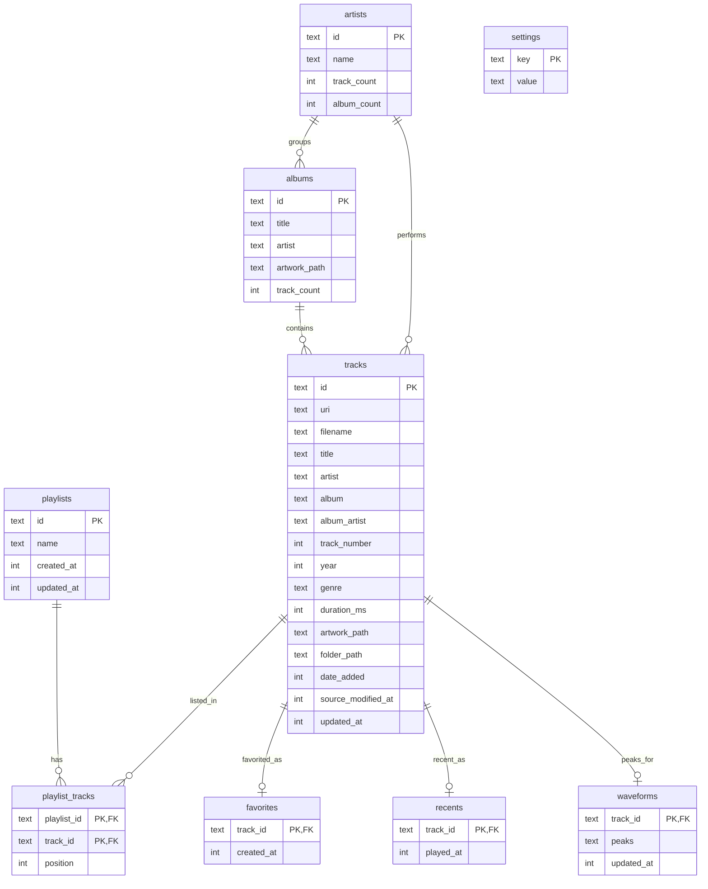

# Muze SQLite ERD

Source of truth for the live schema: `src/lib/db/schema.ts` (`muze.db`, version 2).

Audio files are **not** stored in the database. Rows hold metadata, user collections, caches, and settings only. Device audio stays on disk and is referenced by `tracks.uri` / MediaStore id.

## Entity relationship diagram

## Relationships

| From        | To                  | Cardinality | Enforced in SQLite?       | Notes                                                           |
| ----------- | ------------------- | ----------- | ------------------------- | --------------------------------------------------------------- |
| `playlists` | `playlist_tracks`   | 1:N         | Yes (`ON DELETE CASCADE`) | Playlist membership + order                                     |
| `tracks`    | `playlist_tracks`   | 1:N         | Yes (`ON DELETE CASCADE`) | Same track can sit in many playlists                            |
| `tracks`    | `favorites`         | 1:0..1      | Yes (`ON DELETE CASCADE`) | Favorite marker                                                 |
| `tracks`    | `recents`           | 1:0..1      | Yes (`ON DELETE CASCADE`) | Last-played timestamp                                           |
| `tracks`    | `waveforms`         | 1:0..1      | Yes (`ON DELETE CASCADE`) | Cached peak JSON/text for seek UI                               |
| `artists`   | `tracks` / `albums` | logical 1:N | No FK                     | Derived from tag fields; ids are stable keys for browse screens |
| `albums`    | `tracks`            | logical 1:N | No FK                     | Same; MediaStore folder "albums" are not used as music albums   |
| `settings`  | -                   | standalone  | -                         | Key/value prefs (theme, display name, etc.)                     |

## Notes

- `tracks.id` is the device media asset id (or app-stable equivalent), not a copied file.
- `source_modified_at` stores MediaLibrary modification time (ms) so scans re-parse only new or changed files.
- After each full scan, missing track ids are pruned; `albums` / `artists` are rebuilt from tag fields (`album` + album-artist/artist, and `artist`).
- Album ids look like `album:<normalized-artist>|<normalized-title>`; artist ids like `artist:<normalized-name>`.
- `waveforms.peaks` stores a compact serialized peak array (~150-200 values), not PCM audio.
- `artwork_path` points at a cached ~400px JPEG thumbnail in app cache, never the original full-resolution embed unless needed later.
- Keep this diagram updated when `DATABASE_VERSION` / `SCHEMA_SQL` changes.
